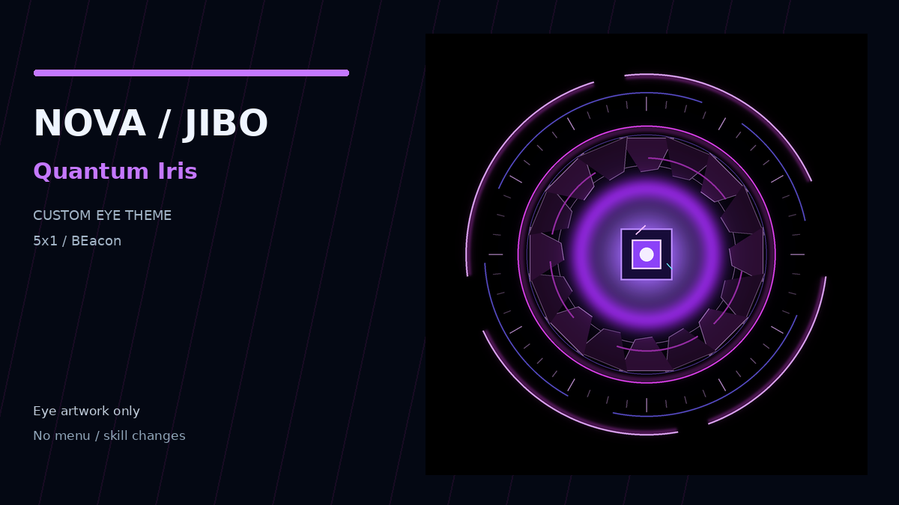

# Quantum Iris

The original purple geometric Quantum Iris eye theme with separate open, closed and listening artwork and an enlarged 122-percent eye.



**Developer:** [Matt87c](https://github.com/Matt87c)  
**Theme version:** 1.0.1  
**Platform:** 5x1/OpenJibo with BEam/BEacon theme support  
**Minimum jibo-tbd:** 3.1.6  
**Eye size:** 122% of standard

## Install (5x1/BEacon)

1. Download the **jibo-quantum-iris-theme.zip** release asset (not GitHub's source-code ZIP).
2. Open **BEacon → Store → Themes → ⋯ → Upload Theme ZIP** and select that file.
3. Select **Quantum Iris**, then choose **Apply**. Upload alone does not apply a theme.
4. To roll back, select the prior theme or **None** to restore Jibo's stock appearance.

## What changes

This is an **eye-only visual theme** with a black background and 122% eye scale. It includes open and listening eye artwork; the native Jibo system retains eye movement, gaze and blinking. This is the earlier Quantum Iris artwork, not the separate screenshot-matched Quantum Iris Cybernetic release.

This package contains no JavaScript, executable skills, personal authentication, network settings, microphone controls or access to external services. It does not replace Hey Jibo, Agent Mode, other skills, NOVA/OpenClaw configuration, firmware, certificates, or system files.

**Important:** BEacon's eye geometry, lighting and native state transitions may alter appearance compared with preview artwork. Hardware testing of this exact public release package has **not yet been confirmed**. Check eye clipping, blink and listening states on the robot before requesting a public Store catalog listing.

## Build and validate

Requires Python 3.9+ and Pillow to validate images (nothing is installed on Jibo):

```sh
python -m pip install 'Pillow>=11,<13'
python scripts/build_release.py
python scripts/validate_release.py
```

The release asset will be at `dist/jibo-quantum-iris-theme.zip` and contains only BEacon's whitelisted theme data, not the build scripts.

## Store publication and attribution

A public GitHub repository with a published **stable release** is required for Store indexing. The release tag must match `manifest.json` (`v1.0.1`), and its attached binary asset must be called `jibo-quantum-iris-theme.zip`. BEacon displays the GitHub owner as the developer. See [Store submission notes](docs/STORE.md).

Independent community artwork and packaging by **Matt87c**. Artwork was generated or adapted for this project; this is not an official Jibo product. Repository code and included art are offered under the [MIT License](LICENSE).
